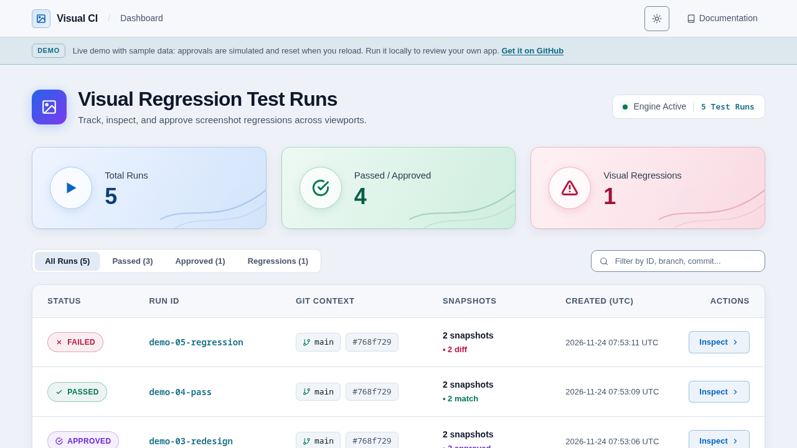
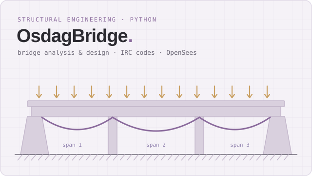
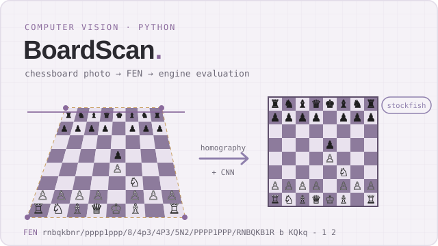
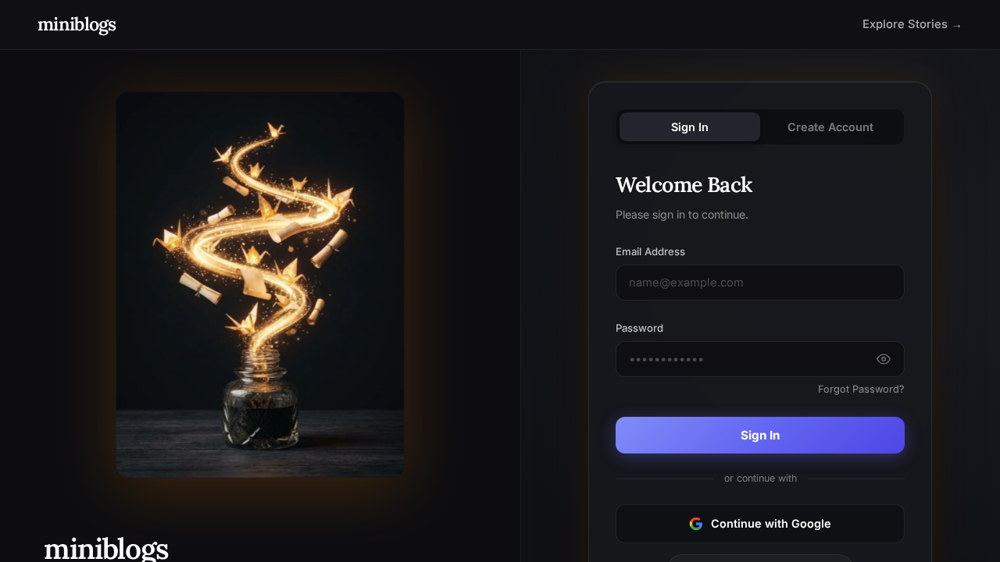

<picture>
  <source media="(prefers-color-scheme: dark)" srcset="assets/banner-dark.svg">
  <source media="(prefers-color-scheme: light)" srcset="assets/banner-light.svg">
  
</picture>

  
  
  
  

### 👋 About me

I'm a CSE student from India who cares about **how software looks and feels**, not just whether it runs. I build web apps with a designer's eye, and I'm branching into **AI/ML** and engineering tools.

- 🔭 **Recently shipped:** a full visual-regression testing dashboard with a [live demo](https://abhishek-k-33.github.io/Visual_Regression_Testing/)
- 🌉 **Working on:** OsdagBridge, a bridge analysis & design module for the open-source [Osdag](https://osdag.fossee.in/) project
- 🌱 **Learning:** AI/ML, computer vision, and writing cleaner, well-tested code
- 💬 **Ask me about:** CSS craft, UI design, chess, or why your layout breaks at 768px

### 🛠️ Featured work

<table>
  <tr>
    <td width="50%" valign="top">
      
      <h4>Visual CI · Visual Regression Testing</h4>
      
Catches CSS that breaks at other screen sizes. Screenshots every viewport, diffs against a baseline, and lets you inspect and approve changes in a dashboard.

      
      
      
      
        
      <b><a href="https://abhishek-k-33.github.io/Visual_Regression_Testing/">Live demo ↗</a></b> · <a href="https://github.com/abhishek-k-33/Visual_Regression_Testing">Code</a>
    </td>
    <td width="50%" valign="top">
      <a href="https://github.com/abhishek-k-33/OsdagBridge"><picture><source media="(prefers-color-scheme: dark)" srcset="assets/osdagbridge-dark.svg"></picture></a>
      <h4>OsdagBridge</h4>
      
A unified bridge analysis &amp; design module for Osdag: IRC design codes, OpenSees solvers, CAD generation and LaTeX reports, all from one Python core that runs as desktop, web or CLI.

      
      
      
        
      <b><a href="https://github.com/abhishek-k-33/OsdagBridge">Code ↗</a></b>
    </td>
  </tr>
  <tr>
    <td width="50%" valign="top">
      <a href="https://github.com/abhishek-k-33/boardscan"><picture><source media="(prefers-color-scheme: dark)" srcset="assets/boardscan-dark.svg"></picture></a>
      <h4>BoardScan ♟️</h4>
      
Snap a photo of a real chessboard from any angle and get back the position as FEN, plus an engine evaluation. Classical CV for board detection, a small CNN for the pieces.

      
      
      
        
      <b><a href="https://github.com/abhishek-k-33/boardscan">Code ↗</a></b>
    </td>
    <td width="50%" valign="top">
      
      <h4>miniblogs</h4>
      
A blogging platform with a lofi/retro feel: full CRUD, auth, Supabase Postgres with row-level security, and a zero-flicker light/dark theme toggle.

      
      
      
        
      <b><a href="https://blogsite-mini25.vercel.app">Live site ↗</a></b> · <a href="https://github.com/abhishek-k-33/blog_site">Code</a>
    </td>
  </tr>
</table>

### 🧰 Toolkit

  <b>Web</b> 
  

  <b>Languages &amp; data</b> 
  

  <b>Tools &amp; design</b> 
  

### 🐍 Contribution snake

<picture>
  <source media="(prefers-color-scheme: dark)" srcset="https://raw.githubusercontent.com/abhishek-k-33/abhishek-k-33/output/snake-dark.svg">
  <source media="(prefers-color-scheme: light)" srcset="https://raw.githubusercontent.com/abhishek-k-33/abhishek-k-33/output/snake.svg">
  
</picture>

### ✨ Off the keyboard

| 🐱 | Certified cat person |
|---|---|
| ☕🍩 | Powered by caffeine and sweets |
| ♟️ | Chess player ([challenge me](https://www.chess.com/member/mysticaldude)), which is why [BoardScan](https://github.com/abhishek-k-33/boardscan) exists |
| 🎨 | Graphic design. The banner and covers on this page are hand-made SVGs |
| 📚🎧 | Books and music, usually at the same time |

### 📫 Let's connect

  
  
  

Thanks for stopping by. If something here caught your eye, star it or open an issue. I'd love to hear from you.

